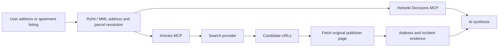

# Property Articles MCP

This document describes the Articles stage of the Finnish Property Intelligence project. Its purpose is to discover Finnish and English news or official press releases that may concern a property, then verify the original page before the AI links an incident to the target building.

The implementation is TypeScript and MCP-based. The former Python/DDGS prototype is no longer the project architecture.

## 1. Role in the project



Articles complements the official property and decision sources:

- Ryhti supplies official addresses and building facts.
- MML supplies place, nearby-building and cadastral context.
- Helsinki Decisions supplies municipal decisions.
- Articles searches media and official press releases for incident context.

Articles is not an official incident register. Missing search results do not prove that nothing happened at a property.

## 2. Current implementation

The MCP package is in `mcp-articles/`:

| File | Responsibility |
| --- | --- |
| `src/index.ts` | MCP tools, bounded article download and response limits |
| `src/article-intelligence.ts` | address normalization, Finnish inflection, query planning, deterministic evidence classification and source allowlist |
| `src/search-provider.ts` | Brave Search and GDELT providers, timeout, cache and response limits |
| `src/article-intelligence.test.ts` | normalization, inflection, matching and URL-safety tests |

The backend starts this package as the `property-articles` MCP server. Docker installs its dependencies and mounts its source for development.

## 3. MCP tools

### `search_property_incident_articles`

Discovers candidate pages. It does not verify that an incident happened at the target building.

Inputs:

- `address`: official address or a listing address such as `Karjalankatu 2 C 23`.
- `district`: optional neighborhood name for a broader contextual search.
- `categories`: any of `fire_rescue`, `crime_police`, `water_damage`, `indoor_air_mold`, `structural_risk`.
- `languages`: `fi`, `en`, or both.
- `includeSameStreet`: enables street-level context; defaults to `false`.
- `includeNeighborhood`: enables neighborhood context; defaults to `false`.
- `freshness`: `all`, `day`, `week`, `month`, or `year`.
- `limit`: 1-10 deduplicated candidate URLs.

The tool removes apartment, staircase, postal-code and city suffixes before searching. For example, `Karjalankatu 2 C 23, 00520 Helsinki` becomes `Karjalankatu 2`.

### `get_property_article_context`

Fetches one candidate from its original publisher and checks the article text for address and incident evidence.

Inputs:

- `url`: candidate publisher URL.
- `address`: target property address.
- `district`: optional neighborhood.
- `maxCharacters`: 1,000-12,000 characters; defaults to 8,000.

The tool returns the title, publication date when available, a bounded text excerpt, content accessibility status and deterministic verification evidence. It does not bypass paywalls.

## 4. Required agent workflow

1. Resolve the user's listing or apartment name to an official parcel-level street address with Ryhti/MML when necessary.
2. Call `search_property_incident_articles` with the official address.
3. Treat every returned item as `search_candidate_only`.
4. Open each candidate used in the answer with `get_property_article_context`.
5. Cite the original publisher URL and distinguish publication date from event date.
6. Report search coverage and limitations when results are empty or incomplete.

The relation levels mean:

| Relation | Meaning | May support a direct-building claim? |
| --- | --- | --- |
| `exact_address` | exact normalized address appears in the article | Yes, only with incident-keyword evidence |
| `inflected_address` | a Finnish inflected form of the address appears | Yes, only with incident-keyword evidence |
| `same_street` | street appears but the target house number is not verified | No; contextual only |
| `neighborhood` | only district/neighborhood evidence appears | No; contextual only |
| `unverified` | no deterministic location match | No |

The boolean `sufficientForIncidentClaim` is true only for `exact_address` or `inflected_address` together with at least one supported incident category. Even then, the AI must read the returned evidence in context; a phrase may describe a nearby property, an old event, or a comparison.

Candidates classified as `unverified` are excluded before the result reaches the AI. `same_street` and `neighborhood` candidates are also excluded unless the caller explicitly enables those scopes. The response reports only aggregate exclusion counts; titles, URLs and event details of excluded search noise are withheld so they cannot leak into the user-facing answer.

## 5. Finnish and English search behavior

Finnish address cases are expanded for common street suffixes:

- `Karjalankatu 2` -> `Karjalankadulla 2`, `Karjalankadun 2`
- `Veturitie 21` -> `Veturitiellä 21`, `Veturitien 21`
- `Kyllikinkuja 4` -> `Kyllikinkujalla 4`, `Kyllikinkujan 4`
- `Pasilanraitio 3` -> local-case variants
- `-polku` and `-kaari` forms are also supported

Supported vocabulary includes:

| Category | Finnish examples | English examples |
| --- | --- | --- |
| Fire and rescue | `tulipalo`, `rakennuspalo`, `huoneistopalo`, `tuhopoltto` | `fire`, `building fire`, `apartment fire`, `arson` |
| Crime and police | `poliisioperaatio`, `asuntomurto`, `puukotus`, `ampuminen` | `police operation`, `burglary`, `stabbing`, `shooting` |
| Water damage | `vesivahinko`, `putkirikko`, `vesivuoto` | `water damage`, `pipe leak`, `water leak` |
| Indoor air and mold | `homeongelma`, `sisäilmaongelma`, `kosteusvaurio` | `mold`, `indoor air problem`, `moisture damage` |
| Structural risk | `sortuma`, `rakenteellinen vaurio`, `sortumisvaara` | `collapse`, `structural damage`, `collapse risk` |

For Brave, exact-address discovery is split by incident category so one oversized OR query cannot dilute the address match; contextual street/neighborhood plans remain grouped. Brave sends at most two requests concurrently. GDELT keeps categories grouped, runs requests sequentially at least 5.5 seconds apart and retries once after HTTP 429.

## 6. Sources and providers

Allowed source domains currently include Finnish media and public authorities such as `yle.fi`, `hs.fi`, `is.fi`, `iltalehti.fi`, `mtvuutiset.fi`, `helsinginuutiset.fi`, `poliisi.fi`, `pelastustoimi.fi`, `hel.fi`, `sttinfo.fi`, `helsinkitimes.fi` and `dailyfinland.fi`.

Provider selection:

- `ARTICLE_SEARCH_PROVIDER=brave`: uses the Brave Web Search API and requires `BRAVE_SEARCH_API_KEY`. This is the recommended option when broader search-index coverage is required.
- `ARTICLE_SEARCH_PROVIDER=gdelt`: keyless fallback using GDELT DOC. Its practical coverage is recent and may miss local, paywalled or historical pages.
- If the provider is not explicitly set, the code selects Brave when a key exists and GDELT otherwise.

Provider documentation:

- Brave Web Search API: <https://api-dashboard.search.brave.com/api-reference/web/search/get>
- GDELT DOC 2.0 API: <https://blog.gdeltproject.org/gdelt-doc-2-0-api-debuts/>

Environment variables are documented in `.env.example`. Never commit a real API key.

## 7. Safety and data limits

- Search responses and article pages have a 2,000,000-character maximum.
- Final MCP results have a 60,000-character maximum.
- Article excerpts are capped at 12,000 characters.
- Search calls time out after 30 seconds; article fetches time out after 20 seconds.
- Search results are cached in memory for five minutes.
- Article URLs must use HTTP(S) and match the source allowlist.
- Every redirect is revalidated, with at most three redirects.
- Tracking parameters beginning with `utm_` are removed during deduplication.
- The MCP never bypasses paywalls and reports `limited_or_paywalled` when useful content cannot be extracted.

These controls reduce prompt-context overflow, accidental arbitrary URL fetching and duplicate searches.

## 8. Evidence-oriented output

The Articles stage should feed evidence into the final property dossier instead of producing an unsupported risk score:

```json
{
  "target_address": "Karjalankatu 2",
  "search_coverage": {
    "provider": "brave_or_gdelt",
    "queries_attempted": 4,
    "queries_failed": 0,
    "coverage_limitation": "Search-index results are incomplete."
  },
  "verified_incidents": [
    {
      "relation": "exact_address",
      "incident_categories": ["fire_rescue"],
      "event_date": "unknown_until_verified_from_article",
      "source_url": "https://publisher.example/article",
      "evidence": ["address excerpt", "incident-keyword excerpt"]
    }
  ],
  "nearby_context": [],
  "uncertainty": "No result is not evidence of no incident history."
}
```

Do not generate `LOW`, `MEDIUM` or `HIGH` property risk from article count alone. A defensible risk assessment would require defined severity criteria, event recency, consequence evidence, official fire/police/insurance records where available, and an explicit uncertainty model.

## 9. Local verification

```bash
docker compose build backend
docker run --rm junctionxturku-backend sh -lc \
  'cd /app/mcp-articles && npm test && npx tsc --noEmit && cd /app/backend && npx tsc --noEmit'
```

Current automated checks cover address cleanup, Finnish inflection, bounded bilingual query generation, exact-address incident matching, same-street separation and rejection of arbitrary/local URLs.
