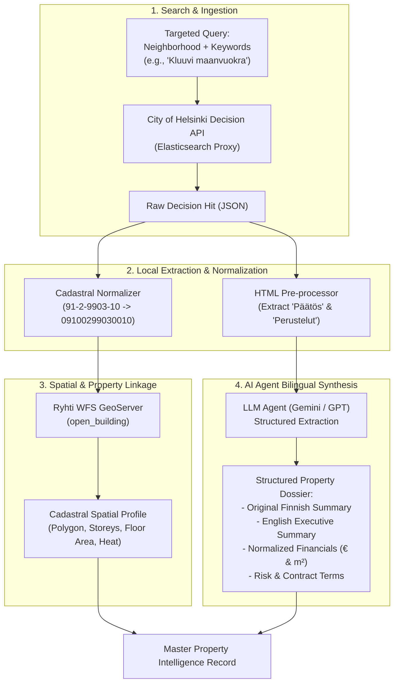

# Technical Specification: Helsinki Municipal Real Estate & Land Decision AI Agent Pipeline

This document provides a comprehensive, end-to-end specification for building an automated AI Agent that queries, parses, cadastral-normalizes, and bilingually summarizes (Finnish & English) municipal land and property decisions from the City of Helsinki (`paatokset.hel.fi`), and connects them to Finland's national built environment spatial registry (**Ryhti WFS**).

---

## 1. System Architecture & Data Flow



---

## 2. API Specification & Query Construction

### 2.1 Production Endpoint Details
* **Base URL:** `https://paatokset-elastic-proxy.api.hel.ninja`
* **Search Endpoint:** `POST /paatokset_decisions/_search`
* **Protocol / Format:** HTTPS / JSON (Elasticsearch query DSL)
* **Authentication:** None required (Public Open Data, CC BY 4.0 license)
* **CORS / Rate Limits:** Open access; polite rate limiting (1–2 requests/sec) is recommended.

### 2.2 Elasticsearch Query Template
To search for land lease agreements, property transactions, or zoning adjustments around specific neighborhoods (e.g., `Kluuvi` for Helsinki Central Station or `Kamppi`):

```json
{
  "query": {
    "bool": {
      "must": [
        {
          "multi_match": {
            "query": "Kluuvi maanvuokra",
            "fields": [
              "subject^3",
              "issue_subject^2",
              "decision_content"
            ]
          }
        }
      ],
      "filter": [
        {
          "term": {
            "top_category_name": "Maankäyttö, rakentaminen ja asuminen"
          }
        }
      ]
    }
  },
  "size": 10,
  "sort": [
    {
      "meeting_date": {
        "order": "desc"
      }
    }
  ],
  "_source": [
    "id",
    "issue_id",
    "subject",
    "issue_subject",
    "category_name",
    "top_category_name",
    "organization_name",
    "meeting_date",
    "decision_url",
    "decision_content"
  ]
}
```

### 2.3 Domain Search Term Dictionary (Finnish)

| Target Domain | Finnish Search Query | English Meaning |
| :--- | :--- | :--- |
| **Ground Lease / Rent** | `"tontin vuokraus" OR "maanvuokra"` | Plot lease / ground rent |
| **Base Annual Rent** | `"perusvuosivuokra"` | Base annual ground lease amount in € |
| **Plot Sales / Acquisition** | `"kiinteistökauppa" OR "tontin myynti"` | Real property transaction / plot sale |
| **Purchase Price** | `"kauppahinta"` | Realized sale price in € |
| **Helsinki Central Station** | `"Kluuvi" OR "Elielinaukio" OR "Asema-aukio"` | District 2 (Central Station area) |
| **Kamppi Adjacent Area** | `"Kamppi" OR "Simonkatu"` | District 4 (Adjacent station area) |

---

## 3. Data Dictionary: Raw Response Schema

The raw document contains the following fields under `hits.hits[]._source`:

| Field Name | Type | Description |
| :--- | :--- | :--- |
| `id` | `string` | Internal unique system node ID (e.g., `entity:node/181031:fi`) |
| `issue_id` | `string` | Official municipal diary ID (e.g., `HEL-2024-012839`) |
| `subject` | `array[str]` | The official title of the decision |
| `issue_subject` | `array[str]` | Summary of the case file; **frequently contains exact street addresses** |
| `top_category_name`| `array[str]` | High-level municipal category (`Maankäyttö, rakentaminen ja asuminen`) |
| `category_name` | `array[str]` | Specific subcategory (e.g., `Lyhyt- ja pitkäaikaiset tonttivuokraukset`) |
| `organization_name`| `array[str]` | Decision-maker office / official title (e.g., `Tiimipäällikkö`) |
| `meeting_date` | `array[int]` | Unix timestamp of when the decision was approved |
| `decision_url` | `array[str]` | Relative URL to view the verified original page on `paatokset.hel.fi` |
| `decision_content` | `array[str]` | **Full HTML content** of the legal decision, contract clauses, and numbers |

---

## 4. Cadastral Parsing & Spatial Normalization Engine

Municipal decisions reference property parcels in human-readable municipal notation (e.g., `91-2-9903-10`). National GIS systems (**Ryhti** and **Maanmittauslaitos - MML**) use a standardized **14-digit numeric Cadastral Identifier (`Kiinteistötunnus`)**.

### 4.1 Normalization Algorithm
A Helsinki municipal parcel string follows the schema: `91-<district>-<block>-<plot>`.

To convert to the 14-digit National Standard:
1. **Municipality Code (`Kuntanumero`):** `91` padded with leading zeros to 3 digits $\rightarrow$ `091`.
2. **District / Neighborhood Code (`Kaupunginosanumero`):** Padded to 3 digits $\rightarrow$ e.g., `2` becomes `002`.
3. **Block / Area Code (`Korttelinumero`):** Padded to 4 digits $\rightarrow$ e.g., `9903` remains `9903`.
4. **Plot / Parcel Code (`Tonttinumero`):** Padded to 4 digits $\rightarrow$ e.g., `10` becomes `0010`.

$$\text{Example: } \mathbf{91\text{-}2\text{-}9903\text{-}10} \implies \mathbf{09100299030010}$$

### 4.2 Querying Ryhti WFS with the Normalized Parcel ID
Once normalized, query the live national Ryhti GeoServer:

* **Endpoint:** `https://paikkatiedot.ymparisto.fi/geoserver/ryhti_building/wfs`
* **Query Parameters:**
  ```text
  service=WFS&version=1.1.0&request=GetFeature&typeName=ryhti_building:open_building&outputFormat=application/json&sykeuserid=ryhti&CQL_FILTER=property_identifier='09100299030010'
  ```
* **Returns:** Building footprints, number of storeys, gross floor area, construction year, heating method, and precise coordinate geometry.

---

## 5. AI Agent Extraction & Bilingual Summarization

Municipal decision bodies generate lengthy texts containing standard appeal guidelines and legal boilerplate that waste tokens. The AI pipeline applies an **HTML Pre-filter** to isolate the operational clauses before prompting the LLM.

### 5.1 HTML Pre-processing Filter
Extract only text under:
* `<h3 class="SisaltoOtsikko">Päätös</h3>` (The operative resolution)
* `<h3 class="SisaltoOtsikko">Päätöksen perustelut</h3>` (The factual and legal grounds)
Ignore `<h3 class="SisaltoOtsikko">Muutoksenhakuohjeet</h3>` (Appeal instructions) and `<h3 class="SisaltoOtsikko">Sovelletut oikeusohjeet</h3>` (Statute listings).

### 5.2 LLM System Prompt & Output Schema

#### System Prompt:
```text
You are an expert Finnish Real Estate Legal Analyst and Data Ingestion Agent.
Your task is to analyze municipal decisions from the City of Helsinki, extract structured financial, spatial, and contractual metrics, and generate both an authentic Finnish summary and an accurate English executive summary.

Rules:
1. Never hallucinate financial figures. If an amount is not explicitly stated, return null.
2. Distinguish clearly between Ground Leases (Maanvuokra), Land/Property Sales (Kiinteistökauppa), and Planning/Zoning decisions (Kaavoitus).
3. Return output strictly adhering to the specified JSON schema.
```

#### JSON Output Schema:
```json
{
  "transaction_type": "Ground Lease | Land Sale | Building Sale | Zoning Amendment | Temporary Lease",
  "party_recipient": "Name of the commercial entity, tenant, or private buyer",
  "street_address": "Street name and number if mentioned, else null",
  "raw_parcel_id": "Municipal parcel code (e.g. 91-2-9903-10)",
  "normalized_parcel_id": "14-digit national code (e.g. 09100299030010)",
  "financials": {
    "base_annual_rent_eur": 1620.98,
    "adjusted_annual_rent_eur": null,
    "total_sale_price_eur": null,
    "price_per_sqm_eur": null
  },
  "spatial_metrics": {
    "land_area_sqm": 2242,
    "permitted_floor_area_sqm": 658
  },
  "timeline": {
    "effective_date": "YYYY-MM-DD",
    "expiration_date": "YYYY-MM-DD or null if indefinite/fixed"
  },
  "summary_fi": "1-2 concise sentences in Finnish summarizing the core administrative decision.",
  "summary_en": "1-2 concise sentences in English providing an executive summary for international investors/analysts.",
  "key_risks_or_conditions": [
    "Specific clauses such as mandatory demolition, index linked rent, ground contamination, or special covenants"
  ]
}
```

---

## 6. Complete Python Implementation Reference

The script below executes the complete pipeline: querying the live Elasticsearch proxy, parsing raw HTML, normalizing parcel IDs, calling the LLM for bilingual extraction, and cross-referencing Ryhti WFS.

```python
"""
Helsinki Municipal Real Estate AI Ingestion Pipeline
Author: Antigravity Agent
License: MIT / CC BY 4.0 (Data Source: Helsingin kaupunki)
"""

import json
import re
import urllib.parse
from bs4 import BeautifulSoup
import requests

# ---------------------------------------------------------------------------
# API Endpoints
# ---------------------------------------------------------------------------
ELASTIC_SEARCH_URL = "https://paatokset-elastic-proxy.api.hel.ninja/paatokset_decisions/_search"
RYHTI_WFS_URL = "https://paikkatiedot.ymparisto.fi/geoserver/ryhti_building/wfs"

# ---------------------------------------------------------------------------
# 1. Cadastral Identifier Normalizer
# ---------------------------------------------------------------------------
def normalize_helsinki_parcel_id(text_parcel: str) -> str:
    """
    Converts Helsinki municipal parcel string (e.g., '91-2-9903-10')
    into the 14-digit National Cadastral ID ('09100299030010').
    """
    if not text_parcel:
        return None
    clean = text_parcel.strip()
    parts = clean.split("-")
    if len(parts) == 4:
        kunta = parts[0].zfill(3)        # 91   -> 091 (Helsinki)
        kaupunginosa = parts[1].zfill(3) # 2    -> 002 (Kluuvi)
        kortteli = parts[2].zfill(4)     # 9903 -> 9903
        tontti = parts[3].zfill(4)       # 10   -> 0010
        return f"{kunta}{kaupunginosa}{kortteli}{tontti}"
    return None

# ---------------------------------------------------------------------------
# 2. HTML Pre-processing Filter
# ---------------------------------------------------------------------------
def extract_operative_decision_text(html_content: str) -> str:
    """
    Strips boilerplate and extracts the core operative sections:
    - 'Päätös' (The Decision)
    - 'Päätöksen perustelut' (Grounds / Context)
    """
    if not html_content:
        return ""

    soup = BeautifulSoup(html_content, "html.parser")
    operative_blocks = []

    # Locate Päätös section
    decision_head = soup.find(lambda t: t.name in ["h2", "h3"] and "Päätös" in t.text)
    if decision_head:
        for sib in decision_head.find_next_siblings():
            if sib.name in ["h2", "h3"]:
                break
            if sib.name == "p":
                text = sib.get_text().strip()
                if text:
                    operative_blocks.append(text)

    # Locate Päätöksen perustelut section
    grounds_head = soup.find(lambda t: t.name in ["h2", "h3"] and "Päätöksen perustelut" in t.text)
    if grounds_head:
        for sib in grounds_head.find_next_siblings():
            if sib.name in ["h2", "h3"]:
                break
            if sib.name == "p":
                text = sib.get_text().strip()
                if text:
                    operative_blocks.append(text)

    return "\n\n".join(operative_blocks) if operative_blocks else soup.get_text()[:2500]

# ---------------------------------------------------------------------------
# 3. Decision Search Query
# ---------------------------------------------------------------------------
def query_helsinki_decisions(keyword: str = "Kluuvi maanvuokra", size: int = 5):
    """
    Executes an Elasticsearch query against the City of Helsinki decisions proxy.
    """
    payload = {
        "query": {
            "bool": {
                "must": [
                    {
                        "multi_match": {
                            "query": keyword,
                            "fields": ["subject^3", "issue_subject^2", "decision_content"]
                        }
                    }
                ],
                "filter": [
                    {"term": {"top_category_name": "Maankäyttö, rakentaminen ja asuminen"}}
                ]
            }
        },
        "size": size,
        "sort": [{"meeting_date": {"order": "desc"}}],
        "_source": [
            "id",
            "issue_id",
            "subject",
            "issue_subject",
            "meeting_date",
            "decision_url",
            "decision_content",
            "category_name",
            "organization_name"
        ]
    }

    headers = {"Content-Type": "application/json"}
    response = requests.post(ELASTIC_SEARCH_URL, json=payload, headers=headers, timeout=10)
    response.raise_for_status()
    return response.json().get("hits", {}).get("hits", [])

# ---------------------------------------------------------------------------
# 4. Ryhti Spatial Linkage
# ---------------------------------------------------------------------------
def fetch_ryhti_cadastral_profile(normalized_parcel_id: str):
    """
    Cross-references Ryhti GeoServer WFS to retrieve spatial attributes
    for the normalized parcel ID.
    """
    if not normalized_parcel_id:
        return None

    params = {
        "service": "WFS",
        "version": "1.1.0",
        "request": "GetFeature",
        "typeName": "ryhti_building:open_building",
        "outputFormat": "application/json",
        "sykeuserid": "ryhti",
        "CQL_FILTER": f"property_identifier = '{normalized_parcel_id}'",
        "maxFeatures": 1
    }

    url = f"{RYHTI_WFS_URL}?{urllib.parse.urlencode(params)}"
    try:
        res = requests.get(url, timeout=10)
        data = res.json()
        features = data.get("features", [])
        if features:
            props = features[0]["properties"]
            geom = features[0]["geometry"]
            return {
                "building_key": props.get("building_key"),
                "completion_year": props.get("completion_date", "")[:4] if props.get("completion_date") else None,
                "storeys": props.get("number_of_storeys"),
                "floor_area_sqm": props.get("floor_area"),
                "main_purpose_code": props.get("main_purpose"),
                "geometry_type": geom.get("type"),
                "coordinates": geom.get("coordinates")
            }
    except Exception as e:
        print(f"Ryhti lookup notice: {e}")
    return None

# ---------------------------------------------------------------------------
# 5. Pipeline Demonstration Runner
# ---------------------------------------------------------------------------
def run_pipeline(search_keyword="Kluuvi maanvuokra", num_results=2):
    hits = query_helsinki_decisions(search_keyword, size=num_results)
    print(f"Retrieved {len(hits)} decisions from Helsinki Decisions API.\n")

    records = []
    for hit in hits:
        src = hit["_source"]
        raw_html = src.get("decision_content", [""])[0] if src.get("decision_content") else ""
        filtered_text = extract_operative_decision_text(raw_html)

        # Regex-based parcel extraction from operative text
        parcel_match = re.search(r"\b(91-\d+-\d+-\d+)\b", filtered_text)
        raw_parcel = parcel_match.group(1) if parcel_match else None
        normalized_parcel = normalize_helsinki_parcel_id(raw_parcel)

        # Cross-reference with Ryhti
        ryhti_profile = fetch_ryhti_cadastral_profile(normalized_parcel)

        record = {
            "decision_id": hit["_id"],
            "issue_id": src.get("issue_id", [""])[0],
            "title_fi": src.get("subject", [""])[0],
            "case_subject": src.get("issue_subject", [""])[0],
            "official_url": f"https://paatokset.hel.fi{src.get('decision_url', [''])[0]}",
            "raw_parcel_id": raw_parcel,
            "normalized_parcel_id": normalized_parcel,
            "filtered_operative_text": filtered_text[:500] + "...",
            "ryhti_spatial_profile": ryhti_profile
        }
        records.append(record)

    return records

if __name__ == "__main__":
    results = run_pipeline(search_keyword="Kluuvi maanvuokra", num_results=2)
    print(json.dumps(results, indent=2, ensure_ascii=False))
```
