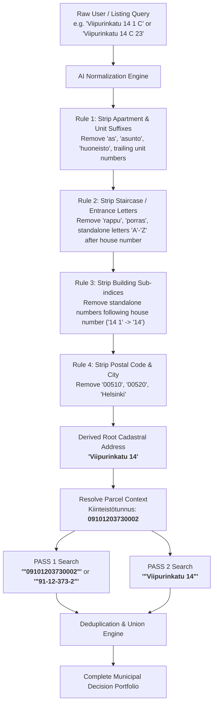

# Helsinki Municipal Real Estate & Land Decision Intelligence Pipeline
## AI Agent Specification & Search Normalization Rules (paatokset.hel.fi)

A high-precision, parcel-first intelligence engine for discovering, verifying, and extracting City of Helsinki municipal decisions (*Päätökset / Ahjo*) affecting real estate parcels.

---

## 1. Executive Summary & Core Design Philosophy

Municipal records in Helsinki (city council, city board, urban environment committee, planning approvals, land leases) are recorded across different eras:
* **Modern records (post-2015/2018):** Frequently contain explicit 14-digit national cadastral codes (`Kiinteistötunnus`, e.g. `09101203730002`) or city planning codes (`91-12-373-2`).
* **Historical records & committee minutes:** Frequently **OMIT** the cadastral code entirely and reference **ONLY** the official street address (e.g. `Viipurinkatu 14`).
* **Keyword trap eliminated:** Previous architectures attempted to filter by housing-specific terms (`asuminen`, `kerrostalo`, `asunto`). **This has been completely eliminated.** Filtering by housing keywords artificially hides vital municipal decisions—such as land lease agreements (*maanvuokrasopimus*), ground rent revisions (*perusvuosivuokra*), zoning amendments (*asemakaavan muutos*), municipal easements (*rasite*), environmental remediation orders (*maaperän puhdistaminen*), and building permits (*rakennuslupa*).

### The Golden Rule: Dual-Pass Quoted Search
For every parcel, the agent executes **EXACTLY TWO SEARCH PASSES** using **EXACT PHRASE QUOTES (`"..."`)**, replicating the exact search behavior of the [`https://paatokset.hel.fi/en`](https://paatokset.hel.fi/en) frontend:
1. **Pass 1 — Cadastral Code Search:** `"Mã số thửa đất"` (e.g. `"09101203730002"` or `"91-12-373-2"`).
2. **Pass 2 — Street Address Search:** `"Địa chỉ nhà gốc"` (e.g. `"Viipurinkatu 14"`).

---

## 2. AI Agent Query Normalization & Broadening Engine

### 2.1. The "Over-Specification" Problem
Users and real estate listings frequently supply overly specific addresses, such as:
* `Viipurinkatu 14 1 C` (Parcel with 3 buildings; building index `1`, staircase `C`)
* `Viipurinkatu 14 C 23` (Staircase `C`, apartment number `23`)
* `Viipurinkatu 14, 00510 Helsinki` (Includes postal code and city)

> [!WARNING]
> **Why Over-Specified Queries Fail on paatokset.hel.fi:**
> Municipal decisions are issued for the **entire property / cadastral parcel**, NEVER for an individual apartment (`C 23`) or internal building index (`1 C`). If the search sends `"Viipurinkatu 14 1 C"` to the decision engine, it will return **0 results**.

### 2.2. Normalization & Broadening Rules (Agent Rulebook)
Before constructing the search query, the AI Agent must parse and broaden the input according to the following normalization hierarchy:



### 2.3. Address Parsing Regex & Rules Table

| Raw Input Example | Extracted Base Street | Extracted House Number | Discarded Over-specific Tokens | Normalized Agent Query (Pass 2) |
| :--- | :--- | :--- | :--- | :--- |
| `Viipurinkatu 14 1 C` | `Viipurinkatu` | `14` | `1` (Building index), `C` (Staircase) | `"Viipurinkatu 14"` |
| `Viipurinkatu 14 C 23` | `Viipurinkatu` | `14` | `C` (Staircase), `23` (Apartment) | `"Viipurinkatu 14"` |
| `Ratapihantie 3 B, 00520` | `Ratapihantie` | `3` | `B` (Staircase), `00520` (Postal code) | `"Ratapihantie 3"` |
| `Asemapäällikönkatu 12 b A 4` | `Asemapäällikönkatu`| `12 b` | `A` (Staircase), `4` (Apartment) | `"Asemapäällikönkatu 12 b"` |
| `Radanrakentajantie 4-6` | `Radanrakentajantie`| `4-6` | Range preserved | `"Radanrakentajantie 4-6"` |

#### Python Normalization Implementation
```python
import re

def normalize_address_for_decisions(raw_address: str) -> str:
    """
    Normalizes complex user/listing addresses to root property address
    suitable for exact-phrase municipal decision search.
    Example: 'Viipurinkatu 14 1 C' -> 'Viipurinkatu 14'
             'Ratapihantie 3 B 15, 00520 Helsinki' -> 'Ratapihantie 3'
    """
    # 1. Remove postal codes and city
    cleaned = re.sub(r",?\s*\b00\d{3}\b.*", "", raw_address, flags=re.I)
    cleaned = re.sub(r"\bhelsinki\b", "", cleaned, flags=re.I).strip()

    # 2. Match street name and main house number (including letter sub-numbers like '12 b' or ranges '4-6')
    # Pattern captures: Group 1 = Street name, Group 2 = House number
    pattern = r"^([a-zA-ZäöåÄÖÅ\s\-]+?)\s+(\d+(?:\s*[-–]\s*\d+)?(?:\s*[a-zäöå])?)"
    match = re.match(pattern, cleaned, flags=re.I)
    if match:
        street_name = match.group(1).strip()
        house_num = match.group(2).strip()
        return f"{street_name} {house_num}"

    return cleaned.strip()
```

---

## 3. Dual-Pass Execution Pipeline

For each cadastral parcel (e.g. from `bbox_parcels.json` or map selection):

```
                       CADASTRAL PARCEL INSTANCE
               [Kiinteistötunnus: 09101203730002 / 91-12-373-2]
               [Official Address: Viipurinkatu 14]
                                 │
         ┌───────────────────────┴───────────────────────┐
         ▼                                               ▼
   PASS 1: PARCEL ID SEARCH                      PASS 2: ADDRESS SEARCH
   ────────────────────────                      ──────────────────────
   Exact Phrase:                                 Exact Phrase:
   • "\"91-12-373-2\""                            • "\"Viipurinkatu 14\""
   • "\"09101203730002\""
   Captures: Modern official deeds,              Captures: Historical city planning,
   zoning codes, land register entries.          zoning notices, older lease minutes.
         │                                               │
         └───────────────────────┬───────────────────────┘
                                 ▼
                     DEDUPLICATION & UNION
                     (Key: unique decision ID / URL)
                                 ▼
                     LLM EXTRACTION & DOSSIER
```

### Why Exact Quotes (`"..."`) Are Mandatory
On `https://paatokset.hel.fi/en`:
* Searching unquoted `Viipurinkatu 14` performs tokenized search matching documents containing "Viipurinkatu" in section 1 and "14" (as a date, chapter, or metric) in section 50 $\rightarrow$ **High false-positive rate**.
* Searching quoted `"Viipurinkatu 14"` performs a continuous string match $\rightarrow$ **Zero false positives**.
* Searching quoted `"91-12-373-2"` precisely locates planning amendments referencing that exact block and lot.

---

## 4. City of Helsinki Decisions API (Ahjo / Elasticsearch)

### 4.1. Endpoint Configuration
* **Search Endpoint:** `https://paatokset-elastic-proxy.api.hel.ninja/paatokset_decisions/_search`
* **HTTP Method:** `POST`
* **Content-Type:** `application/json`

### 4.2. Elasticsearch Query DSL (Pass 1 — Parcel ID)
```json
{
  "query": {
    "bool": {
      "must": [
        {
          "multi_match": {
            "query": "\"91-12-373-2\"",
            "type": "phrase",
            "fields": [
              "subject^3",
              "issue_subject^2",
              "decision_content"
            ]
          }
        }
      ]
    }
  },
  "size": 50,
  "sort": [
    { "meeting_date": { "order": "desc" } }
  ]
}
```

### 4.3. Elasticsearch Query DSL (Pass 2 — Normalized Address)
```json
{
  "query": {
    "bool": {
      "must": [
        {
          "multi_match": {
            "query": "\"Viipurinkatu 14\"",
            "type": "phrase",
            "fields": [
              "subject^3",
              "issue_subject^2",
              "decision_content"
            ]
          }
        }
      ]
    }
  },
  "size": 50,
  "sort": [
    { "meeting_date": { "order": "desc" } }
  ]
}
```

---

## 5. Match Classification & Deterministic Verification

When results are merged from Pass 1 and Pass 2, the AI Agent assigns an evidence tag to each document:

| Match Category | Criteria | Legal & Technical Significance |
| :--- | :--- | :--- |
| `exact_parcel_and_address` | Matched in both Pass 1 (ID) and Pass 2 (Address) | **Highest confidence**: Definitive parcel record. |
| `exact_parcel_id_only` | Matched Pass 1 (`"91-12-373-2"`), address omitted in text | **Confirmed**: Cadastral ID proves parcel identity. |
| `address_match_only` | Matched Pass 2 (`"Viipurinkatu 14"`), historical doc omitting ID | **High confidence**: Historical decision belonging to this site. |
| `broader_block_context` | Decision covers entire city block (`Kortteli 373`) | **Contextual**: Affects parcel zoning/building rights. |

---

## 6. Structured Output Schema (Parcel Decision Dossier)

The pipeline produces a JSON dossier for each parcel:

```json
{
  "parcel_context": {
    "kiinteistotunnus": "09101203730002",
    "text_format": "91-12-373-2",
    "official_address": "Viipurinkatu 14",
    "raw_user_query": "Viipurinkatu 14 1 C",
    "normalized_search_address": "Viipurinkatu 14"
  },
  "search_execution": {
    "pass_1_parcel_id_query": "\"91-12-373-2\"",
    "pass_1_hits": 4,
    "pass_2_address_query": "\"Viipurinkatu 14\"",
    "pass_2_hits": 7,
    "total_unique_decisions_found": 8
  },
  "decisions": [
    {
      "decision_id": "helsinki_ahjo_2024_10821",
      "issue_id": "HEL 2024-001294",
      "subject": "Tontin 91-12-373-2 maanvuokrasopimuksen uusiminen (Viipurinkatu 14)",
      "meeting_date": "2024-04-16",
      "organization_name": "Kaupunkiympäristölautakunta",
      "official_url": "https://paatokset.hel.fi/fi/asia/hel-2024-001294/...",
      "match_classification": "exact_parcel_and_address",
      "found_by_passes": ["pass_1", "pass_2"],
      "extraction": {
        "decision_type": "Maanvuokra (Ground Lease Renewal)",
        "annual_rent_eur": 42500,
        "lease_expiration_date": "2074-12-31",
        "permitted_floor_area_sqm": 2150,
        "special_conditions": [
          "Rakennusoikeuden tarkistus asemakaavan mukaisesti",
          "Melusuojausvelvoite pääradan puolella"
        ],
        "summary_en": "Renewal of long-term ground lease for parcel 91-12-373-2 until 2074 with base annual rent of 42,500 EUR."
      }
    }
  ]
}
```

---

## 7. Acceptance Criteria & Test Validation

1. **Over-Specification Test:**
   * Given input `Viipurinkatu 14 1 C`, the agent MUST normalize to `Viipurinkatu 14`.
   * Searching `"Viipurinkatu 14 1 C"` on `paatokset.hel.fi` returns 0 hits.
   * Searching normalized `"Viipurinkatu 14"` returns all valid decisions.
2. **Historical Completeness Test:**
   * Decisions dating before 2010 that only cite `Viipurinkatu 14` without cadastral code `91-12-373-2` MUST be captured via Pass 2.
3. **No False Positives from Unquoted Terms:**
   * All queries sent to Elasticsearch MUST be wrapped in double quotes (`"..."`) with `type: "phrase"`.
4. **No Housing Keyword Truncation:**
   * No term filters like `asuminen`, `kerrostalo`, or `asunto` are appended to the query.
